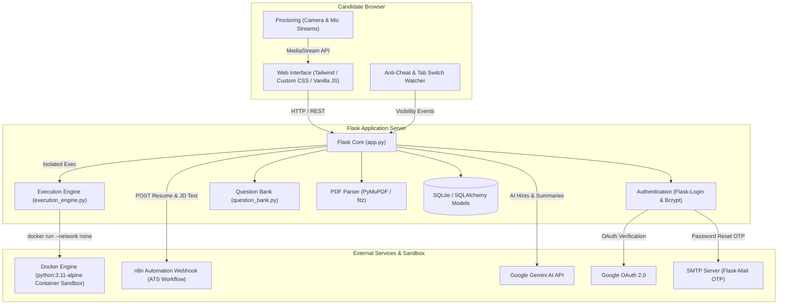

# 🚀 Interview.ai — Next-Gen AI Technical Interview & Assessment Platform

[](https://www.python.org/)
[](https://flask.palletsprojects.com/)
[](https://www.docker.com/)
[](https://n8n.io/)
[](LICENSE)

**Interview.ai** is an enterprise-grade, full-stack AI-assisted technical interview and candidate evaluation platform. It delivers an end-to-end recruitment journey: from PDF resume parsing and automated ATS job-description alignment via n8n automation, to AI-proctored technical MCQ evaluations, isolated containerized live coding assessments in Docker, dynamic real-time dashboard analytics, and tamper-evident certificate generation.

---

## 🌟 Key Features

### 1. 📄 Real n8n-Powered ATS Resume Analyzer
* **Zero Fake Data Policy:** Eliminates static fallbacks or mocked scores. Resume analysis is strictly derived from live workflows.
* **PyMuPDF Extraction:** Ingests candidate resumes in PDF format and cleanly parses structural text, project experience, and technical skill stacks.
* **Synchronous Webhook Orchestration:** Communicates with an authoritative n8n workflow endpoint to compute:
  * Exact ATS compatibility score (0–100%)
  * Job description keyword and skill match ratings
  * Identified candidate strengths and targeted growth areas
  * Critical missing skills and personalized preparation recommendations
  * Granular category score breakdowns (Technical Skills, Experience, Education, Formatting)
* **Empty-State Workspace:** Fresh analysis sessions start clean, preserving historical analyses in the database without unwanted pre-population.

### 2. 🎯 10 Dedicated Technical Domains
Candidates select from 10 distinct, industry-aligned career tracks with tailored question banks, coding challenges, and evaluation rubrics:
1. **Full Stack Development** (Node.js, React, APIs, Databases, System Architecture)
2. **Frontend Engineering** (Modern JavaScript/TypeScript, React, CSS Architecture, Web Performance)
3. **Backend Engineering** (Microservices, Distributed Systems, SQL/NoSQL, Concurrency, Caching)
4. **Machine Learning & AI** (PyTorch, TensorFlow, Feature Engineering, Deep Learning, MLOps)
5. **Data Science & Analytics** (Pandas, Statistical Analysis, Data Pipelines, Modeling, BI)
6. **DevOps & Cloud Engineering** (CI/CD, Kubernetes, Docker, Terraform, AWS/GCP Cloud Architecture)
7. **Cybersecurity** (Application Security, Network Defenses, Cryptography, Penetration Testing)
8. **Mobile App Development** (React Native, Flutter, iOS/Android Lifecycle, State Management)
9. **QA & Automation Testing** (Selenium, Cypress, Test Strategy, API Testing, Unit Testing)
10. **Systems & Embedded Engineering** (C/C++, OS Concepts, Memory Management, Linux Internals)

### 3. 📹 Proctoring & Intelligent Camera Stream Recovery
* **System Readiness Gate:** Enforces microphone, camera, and network connectivity verification prior to entering assessments.
* **Physical Device Selection:** Queries `navigator.mediaDevices.enumerateDevices()` to prioritize genuine built-in laptop webcams over virtual camera drivers or tethered mobile phones.
* **Resilient Media Lifecycle:** Detects camera disconnection or hardware interrupts during assessments and provides an instantaneous, one-click `Enable Camera Again` stream re-acquisition pipeline without losing exam state or answers.

### 4. 🐳 Sandboxed Docker Coding Execution Engine
* **Containerized Isolation:** Executes candidate-submitted Python code inside ephemeral `python:3.11-alpine` containers using the native Docker CLI.
* **Hardened Security Constraints:**
  * `--network none`: Disables all outbound and inbound network access, preventing SSRF, reverse shells, or remote resource fetches.
  * Strict memory caps (`--memory 128m`) and swap prevention.
  * Execution timeouts (5–10 seconds) to terminate infinite loops and fork bombs.
* **Multi-Test Case Evaluation:** Runs code against visible sample test cases and hidden edge test suites, streaming execution output, stderr, and runtime status directly to the candidate UI.

### 5. 🗺️ Multi-Stage Guided Interview Journey
Enforces strict gate logic to ensure candidates follow an authentic recruitment journey:
* **Stage 1 — Resume Analysis:** Upload PDF resume, supply target job description, select domain track.
* **Stage 2 — System Readiness:** Hardware validation and proctoring consent.
* **Stage 3 — Technical MCQ:** Timed domain-specific multi-choice examination with randomized options and anti-cheat tab-focus tracking.
* **Stage 4 — Coding Assessment:** Algorithmic problem solving in an interactive code editor backed by the Docker execution engine.
* **Stage 5 — Results & Certification:** Comprehensive multi-factor evaluation summary and verifiable digital certificate issuance.

### 6. 📊 Real-Time Database-Driven Dashboard
* **Dynamic Analytics:** Metrics such as average performance score, completed sessions, peak performance, and domain intelligence are calculated dynamically from SQLAlchemy models.
* **Zero Hardcoded Data:** Displays actual user attempts, domain progress indicators, and historical activity feeds.

### 7. 🔐 Robust Authentication & Role Control
* Dual authentication support: Email/Password with salted Bcrypt hashing and Google OAuth 2.0 Single Sign-On.
* Single-use OTP password recovery via Flask-Mail.
* Role-based access separating standard candidate accounts from administrative monitoring consoles.

---

## 🏗️ System Architecture



---

## 📁 Project Directory Structure

```text
AI-Interview-Assistant/
├── .env.example                  # Environment variable configuration template
├── .gitignore                    # Git exclusion rules (protects credentials, databases, uploads)
├── app.py                        # Central Flask application, routes, models, and business logic
├── execution_engine.py           # Docker-based isolated code runner and test evaluator
├── question_bank.py              # Domain questions, MCQ options, and coding problem definitions
├── requirements.txt              # Production Python package dependencies
├── database/                     # SQLite database storage directory
│   └── .gitkeep
├── questions/                    # Additional domain question configurations and test cases
├── static/
│   ├── css/                      # Stylesheets (dashboard, resume analyzer, interview, editor)
│   ├── js/                       # Client scripts (interview proctoring, camera recovery, code runner)
│   └── uploads/                  # Upload directories
│       ├── profile/              # User profile avatars (default.png tracked)
│       └── resumes/              # Candidate uploaded resumes (.gitkeep tracked)
├── templates/                    # Jinja2 HTML templates
│   ├── index.html                # Landing page
│   ├── login.html                # Authentication portals
│   ├── dashboard.html            # Real-time candidate analytics dashboard
│   ├── resume_analyzer.html      # ATS resume analysis workspace
│   ├── interview_system_readiness.html  # Hardware & proctoring check
│   ├── interview_mcq.html        # Timed technical MCQ assessment
│   ├── interview_coding.html     # Sandboxed coding assessment editor
│   ├── interview_results.html    # Performance breakdown
│   ├── certificate.html          # Verifiable completion certificate
│   └── admin.html                # Platform management console
└── tests/                        # Comprehensive automated unittest suite
    ├── test_coding_assessment_upgrade.py
    ├── test_coding_execution.py
    ├── test_dashboard_production_real.py
    ├── test_end_to_end_resume_workflow.py
    ├── test_interview_journey.py
    ├── test_mcq_proctoring_readiness.py
    ├── test_resume_analyzer_api_fixes.py
    └── test_resume_empty_workspace.py
```

---

## 🛠️ Technology Stack

| Layer | Technologies |
| :--- | :--- |
| **Backend Core** | Python 3.10+, Flask 3.x, Werkzeug |
| **ORM & Database** | Flask-SQLAlchemy, SQLite (PostgreSQL compatible) |
| **Security & Auth** | Flask-Login, Flask-Bcrypt, Google OAuth 2.0, itsdangerous |
| **Document Processing** | PyMuPDF (`fitz`) for high-fidelity PDF text extraction |
| **Code Execution Sandbox** | Docker Engine, Alpine Linux (`python:3.11-alpine`) |
| **Automation & AI** | n8n Webhook Workflow, Google Gemini 1.5 Pro / Flash |
| **Email Services** | Flask-Mail (SMTP with TLS for one-time password delivery) |
| **Frontend** | Semantic HTML5, Modern CSS (Glassmorphism, CSS Grid), Vanilla JavaScript ES6+ |
| **Testing** | Python `unittest` framework |

---

## ⚙️ Prerequisites

Before running the application, ensure you have the following installed:

1. **Python 3.10 or higher**: [Download Python](https://www.python.org/downloads/)
2. **Git**: [Download Git](https://git-scm.com/)
3. **Docker Desktop**: [Install Docker Desktop](https://www.docker.com/products/docker-desktop/) *(Required for the sandboxed coding evaluation engine)*
4. **n8n Instance** *(Optional for local testing, required for live ATS analysis)*:
   * Can be hosted locally via Docker: `docker run -it --rm --name n8n -p 5678:5678 -v ~/.n8n:/home/node/.n8n n8nio/n8n`
   * Or use an n8n Cloud / self-hosted production webhook endpoint.

---

## 🚀 Quick Start Guide (Windows PowerShell)

### 1. Clone the Repository
```powershell
git clone https://github.com/gallajagadeesh17/AI-Interview-Assistent.git
cd AI-Interview-Assistent
```

### 2. Create and Activate a Virtual Environment
```powershell
python -m venv .venv
.\.venv\Scripts\Activate.ps1
```
*(On macOS/Linux: `source .venv/bin/activate`)*

### 3. Install Dependencies
```powershell
pip install --upgrade pip
pip install -r requirements.txt
```

### 4. Configure Environment Variables
Copy the template configuration file:
```powershell
Copy-Item .env.example .env
```
Edit `.env` and configure your credentials:
```ini
# Flask Secret Key
SECRET_KEY=your-generated-random-secret-key

# n8n Webhook Endpoint for ATS Analysis
N8N_WEBHOOK_URL=http://localhost:5678/webhook/interview-analysis

# Google Gemini API Key
GEMINI_API_KEY=your-gemini-api-key

# Optional: Google OAuth (for Google Login)
GOOGLE_CLIENT_ID=your-google-client-id
GOOGLE_CLIENT_SECRET=your-google-client-secret
GOOGLE_REDIRECT_URI=http://127.0.0.1:5000/login/google/callback

# Optional: SMTP Email (for Password Reset OTP)
MAIL_SERVER=smtp.gmail.com
MAIL_PORT=587
MAIL_USE_TLS=True
MAIL_USERNAME=your-email@gmail.com
MAIL_PASSWORD=your-app-password
MAIL_DEFAULT_SENDER=your-email@gmail.com
```

### 5. Pull Docker Sandbox Image
Ensure Docker Desktop is running, then pull the lightweight Python execution image:
```powershell
docker pull python:3.11-alpine
```

### 6. Run the Application
```powershell
python app.py
```
Open your web browser and navigate to:
```text
http://127.0.0.1:5000
```

---

## 🧪 Running Automated Tests

The repository includes a comprehensive unit testing suite covering API endpoints, proctoring camera recovery, database integrity, and execution engines:

### Run the Full Test Suite
```powershell
python -m unittest discover -s tests -p "test_*.py"
```

### Run Specific Test Modules
```powershell
# Test Camera Proctoring and Hardware Readiness
python -m unittest tests.test_mcq_proctoring_readiness

# Test Real Database-Driven Dashboard Analytics
python -m unittest tests.test_dashboard_production_real

# Test Sandboxed Coding Assessment Engine
python -m unittest tests.test_coding_execution

# Test ATS Resume Webhook Pipeline
python -m unittest tests.test_resume_workflow_real
```

---

## 🔒 Security & Data Privacy

* **Zero Credentials in Git:** The repository `.gitignore` strictly excludes `.env`, all SQLite databases (`*.db`), candidate uploaded files, temporary certificates, and private credentials.
* **Isolated Execution:** User-submitted Python code is executed in non-root Docker containers with no internet access (`--network none`), limited CPU shares, and a 128 MB RAM limit.
* **Client Camera Privacy:** Video and audio streams captured during proctored exams are processed directly in the client browser for live verification and are not stored permanently without candidate authorization.
* **Session Cryptography:** Authentication tokens, password hashes, and session cookies use SHA-256 and bcrypt with configurable work factors.

---

## 
 👥 Project Team

This project was collaboratively developed by a team of B.Tech students at **Ganpat University**.

| No. | Team Member |
|---:|---|
| 1 | Galla jagadeesh  |
| 2 | Devarapu Prakash |
| 3 | Srinivas Reddy   |
| 4 | Linga Chary      |

---

## 📄 License

Distributed under the MIT License. See `LICENSE` for more information.

---
